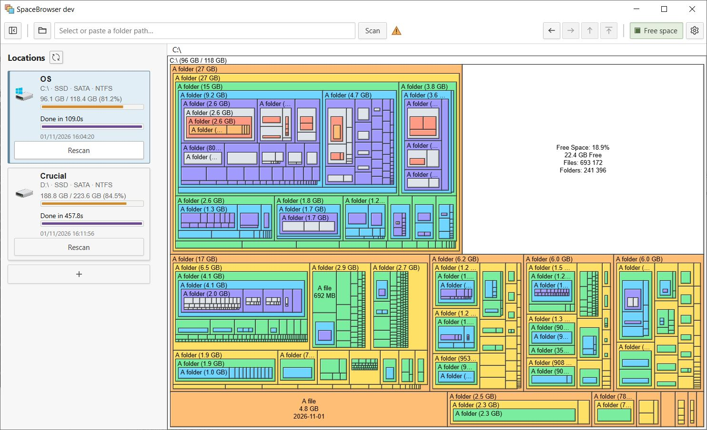

<div align="center">

  <p align="center">
    
  </p>

  <p align="center">
    <a href="https://github.com/Kiord/SpaceBrowser/releases">
      
    </a>
    <a href="LICENSE">
      
    </a>
    
    <a href="https://github.com/wailsapp/awesome-wails">
      
    </a>
    <br>
   
    
    

  </p>

</div>

<br>

Visualize disk usage with an interactive [treemap](https://en.wikipedia.org/wiki/Treemapping). Find large files and folders, and reclaim storage space.

<div align="center">



<br>

**[Download SpaceBrowser](https://github.com/Kiord/SpaceBrowser/releases)**

</div>


## Features

SpaceBrowser recreates the main features of [SpaceMonger 1.4](https://github.com/seanofw/spacemonger1) in a modern, cross-platform application.

<details>
<summary>Show all features</summary>

### Visualization and scanning

- Size-proportional treemap for files and folders
- Locations sidebar with disk usage and storage details
- Optional free-space node for scanned volumes
- Configurable small-file aggregation threshold
- Live scan display with pause, resume, and cancel controls
- Saved scans across app restarts, with cache management
- Rescan selected folders and automatically update overlapping scans
- Exclusions for paths, hidden files, symlinks, and network filesystems

### Navigation and actions

- Folder breadcrumbs and Back, Forward, Parent, and Root commands
- Customizable tooltips with dates, sizes, icons, and file/folder counts
- "Open" and "Open with…" commands for files and folders
- Multiple selection for batch opening and deletion
- Move-to-trash and permanent deletion with protection for sensitive filesystem locations
- Restore trash items and empty trash

### Customization

- Configurable colors, scale, spacing, shape, shading, and hover highlighting
- Live previews for appearance settings
- Rebindable keyboard shortcuts
- Persistent application settings

### Platforms

- **Windows:** Supported
- **Linux:** Supported
- **macOS:** Build available, but not yet tested

</details>

## Installation

Download the latest available version from the **[GitHub Releases](https://github.com/Kiord/SpaceBrowser/releases)** page.

| Platform | Available packages |
|---|---|
| Windows | MSI installer, portable EXE |
| Linux | DEB, RPM, portable binary, setup TAR.GZ |
| macOS | DMG, ZIP (untested) |

Linux setup archives include `Install.sh`; macOS packages include `Install.command`.
Setup offers optional "Scan with SpaceBrowser" file-manager shortcuts.

> **Note:** macOS builds are provided but have not yet been tested. Feedback and bug reports are welcome.


<details>
<summary>Build from source</summary>

### Prerequisites

- [Go 1.27.2](https://go.dev/dl/)
- [Wails v2 development dependencies](https://wails.io/docs/gettingstarted/installation/)

### Clone and install build tools

```sh
git clone https://github.com/Kiord/SpaceBrowser.git
cd SpaceBrowser
go install github.com/wailsapp/wails/v2/cmd/wails@v2.17.0
```

### Build

```sh
wails build
```

</details>

## Usage

Select a location in the sidebar, or enter a folder path to scan.
Pass a path on the command line to scan it at startup.

<details>
<summary>Command-line options</summary>

```text
Usage: spacebrowser [path] [options]

Launch SpaceBrowser and optionally begin scanning path.

Options:
      --no-cache         Disable saved-scan loading/saving for this session
      --cache            Enable saved-scan caching (default)
  -v, --verbosity level  Logging verbosity: 0=critical, 1=error,
                         2=warning, 3=info, 4=debug, 5=trace (default 3)
  -h, --help             Show this help
      --version          Show the SpaceBrowser version
```

</details>


## Contributing

Contributions, bug reports and suggestions are welcome!

- [Report a bug or request a feature](https://github.com/Kiord/SpaceBrowser/issues)
- Share feedback, especially about Linux and macOS compatibility


